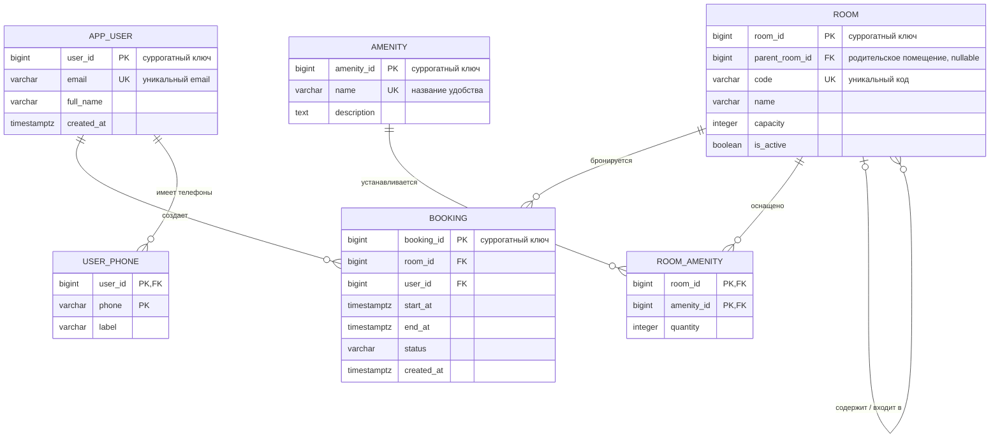

# ER-диаграмма системы управления коворкингом

Используется нотация Crow's Foot: `||` - ровно один, `o|` - ноль или один, `o{` - ноль или много.

## Кардинальности и обязательность

| Связь | Кардинальность | Обязательность |
|---|---|---|
| Пользователь - бронирование | 1:N | У бронирования обязательно один пользователь. У пользователя может быть от 0 до N бронирований |
| Комната - бронирование | 1:N | У бронирования обязательно одна комната. У комнаты может быть от 0 до N бронирований |
| Комната - удобство | M:N через `room_amenity` | Каждая запись связки обязательно ссылается на одну комнату и одно удобство. У каждой стороны может быть от 0 до N связок |
| Пользователь - телефон | 1:N | Телефон обязательно принадлежит одному пользователю. У пользователя может быть от 0 до N телефонов |
| Помещение - родительское помещение | рекурсивная 1:N | У помещения может не быть родителя или быть один родитель. У родителя может быть от 0 до N дочерних помещений |

## Ключи и многозначные атрибуты

- `PK` — первичный ключ; `FK` — внешний ключ; `UK` — альтернативный (уникальный) ключ.
- Основные сущности используют суррогатные ключи: `user_id`, `room_id`, `booking_id`, `amenity_id`.
- Естественные уникальные значения: email пользователя, код помещения и название удобства.
- У пользователя может быть несколько телефонов. Поэтому телефоны вынесены из `app_user` в отдельную таблицу `user_phone`.
- `room_amenity` — ассоциативная таблица, реализующая M:N. Составной PK запрещает дублировать пару «комната — удобство».
- `user_phone` — зависимая (слабая) сущность: ее составной PK включает FK пользователя; без пользователя запись телефона не имеет смысла.
- Рекурсивная связь нужна для иерархии, например этаж → зона → комната. Циклы иерархии в этой версии схемы отдельно не запрещаются.
